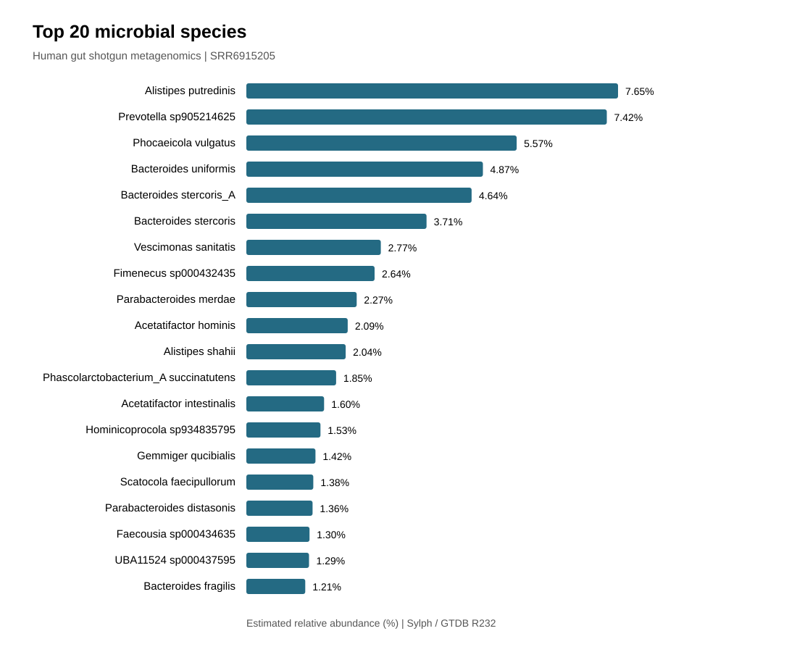
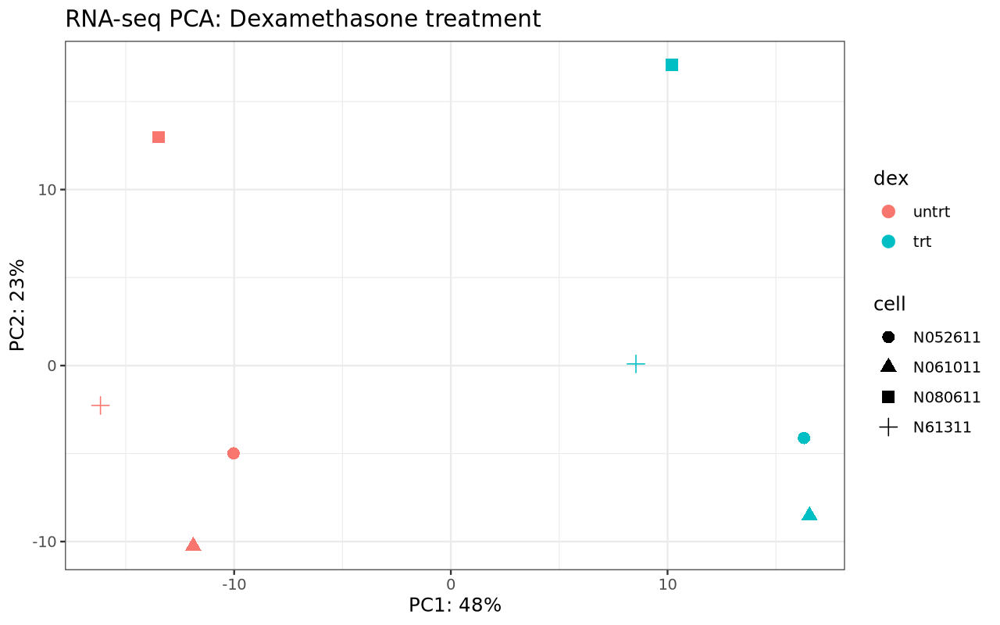
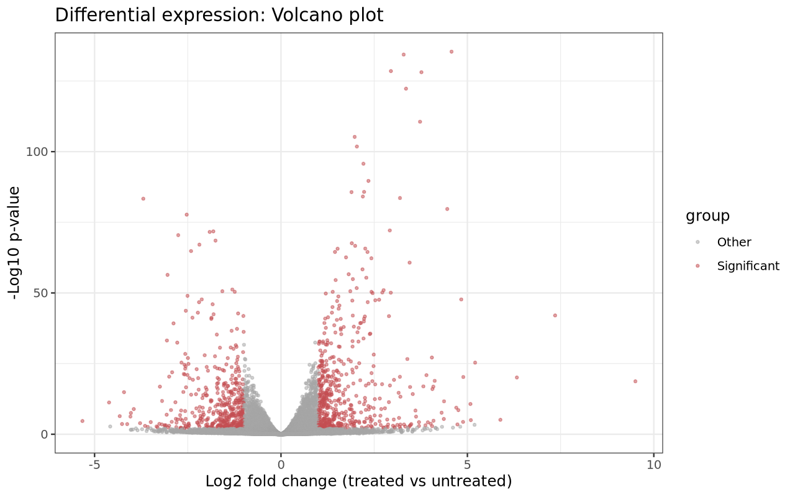
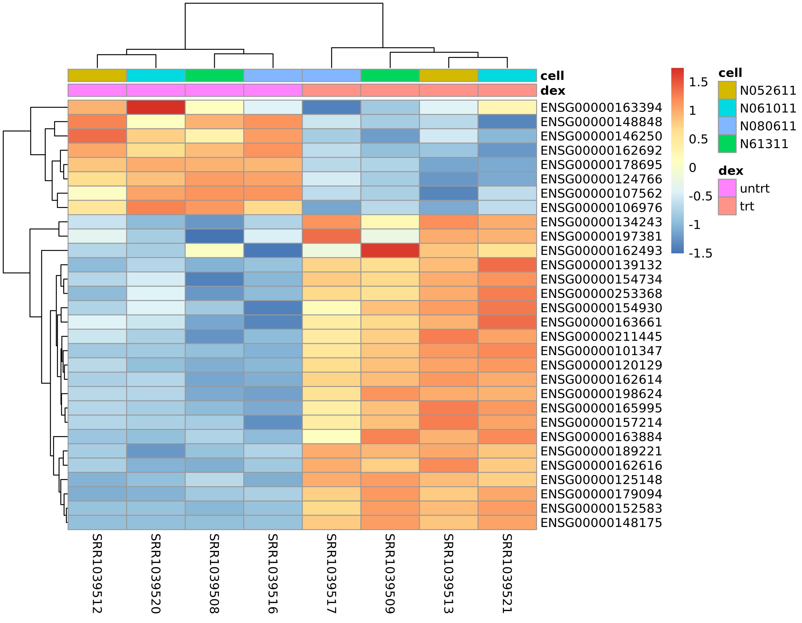
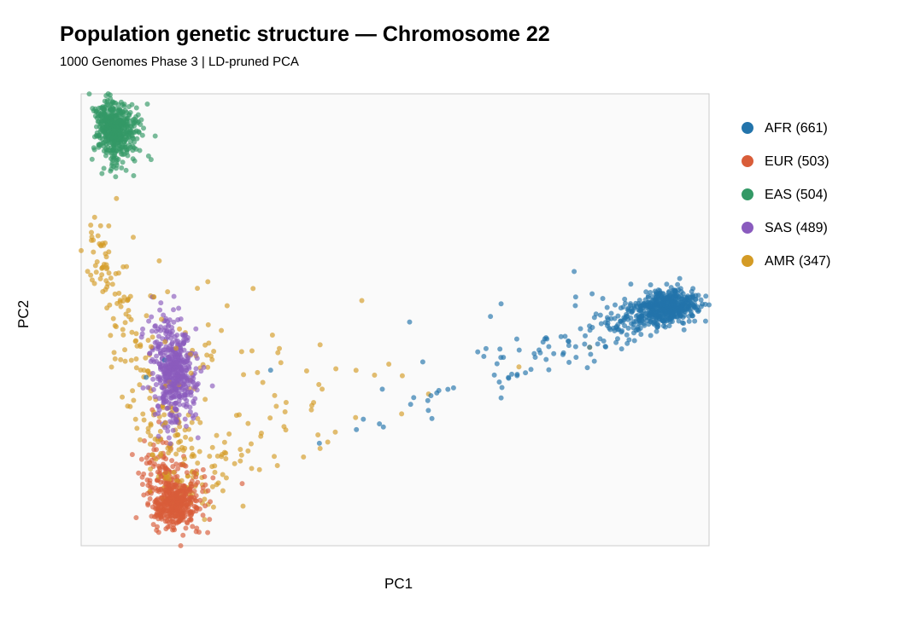
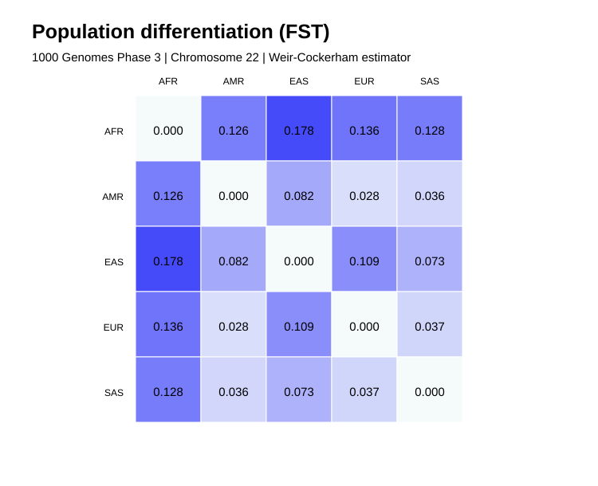

# Bioinformatics Research Portfolio

**Duaa Abdulmohsin | MSc Medical Biology & Genetics**

Molecular biology researcher with a background in experimental
gene-expression research and a first-author publication.
Currently building practical bioinformatics experience through
independent analysis of public genomic and sequencing datasets.

**Research areas:** Genomics, transcriptomics, metagenomics,
molecular genetics, and computational biology.

[LinkedIn](https://www.linkedin.com/in/duaa-abdulmohsin)

---

**Project scope:** Independent, practice-based bioinformatics analyses of public datasets, developed while building computational skills.

## Research Projects

### 01 · Human Gut Shotgun Metagenomics

**Status:** Analysis and documentation completed

Processed 27.3 million sequencing reads through quality control,
read preprocessing, human-reference screening, and taxonomic profiling.

**Tools:** FastQC, fastp, Bowtie2, SAMtools, Sylph, GTDB R232.

[Explore Project 01](shotgun-metagenomics/)

### 02 · Dexamethasone-Induced Gene Expression | RNA-seq

**Status:** Analysis and documentation completed

Analyzed eight human airway smooth muscle RNA-seq samples
using gene-level counts from Bioconductor's airway dataset.

Identified **1,018 differentially expressed genes** after
accounting for cell-line effects.

**Tools:** R, DESeq2, airway, ggplot2, pheatmap.

**Scope:** Differential expression from published counts;
raw FASTQ processing was not performed.

[Explore Project 02](rnaseq/)

### 03 · Human Population Genomics

**Status:** Analysis and documentation completed

Analyzed chromosome 22 genetic variation from 2,504 participants
in the 1000 Genomes Project Phase 3, including PCA and pairwise FST.

**Tools:** PLINK2, Python.

[Explore Project 03](population-genetics/)

---

## Published Research

**First-author peer-reviewed publication | 2025**

**Does taking L-Carnitine and Cadmium have an impact on gene
expression of the liver tissues from rat models?**

*Bangladesh Journal of Medical Science*, 24(2), 614–620.

[Read the publication](https://doi.org/10.3329/bjms.v24i2.81728)

Investigated cadmium, L-carnitine, and the expression of
mTOR, Akt1, and Akt2 in rat liver tissue using experimental
molecular biology and statistical analysis.

**Selected finding:** A reported pairwise comparison identified
a difference in Akt1 expression between the cadmium-only and
cadmium plus L-carnitine groups (p < 0.0001).
However, the overall ANOVA was not significant (p = 0.113),
so this finding requires cautious interpretation.

---

## Featured Results

### 01 · Human Gut Microbiome

Shotgun metagenomic reads were processed, screened for human-origin reads, and profiled against GTDB R232.

**Selected finding:** The most abundant assigned species-level taxon was *Alistipes putredinis* (7.65%). Results describe one sample and do not establish disease associations.

[Explore the metagenomics project](shotgun-metagenomics/)

### 02 · Dexamethasone RNA-seq

Eight RNA-seq samples were analyzed with DESeq2,
adjusting for the four cell lines.

**Selected finding:** 1,018 genes met the differential
expression thresholds (adjusted p < 0.05 and |log2FC| >= 1).

[Explore the RNA-seq project](rnaseq/)

### 03 · Human Population Genomics

Chromosome 22 genotypes from 2,504 1000 Genomes Phase 3 participants were analyzed to investigate patterns of population genetic structure and differentiation.

**Selected finding:** The highest observed pairwise FST was between AFR and EAS (0.1780); these are chromosome 22 estimates, not genome-wide values.

[Explore the population genomics project](population-genetics/)

---

## Technical Skills

- **Linux & Bash:** Command-line bioinformatics workflows
- **Python:** Data processing and scientific visualization
- **NGS quality control:** FastQC and fastp
- **Metagenomics:** Bowtie2, SAMtools, Sylph, GTDB
- **RNA-seq:** R, DESeq2, ggplot2, pheatmap
- **Population genomics:** PLINK2, LD pruning, PCA, FST
- **Research practice:** Statistical interpretation,
  scientific documentation, Git and GitHub

## Reproducibility

Each completed project includes analysis scripts, selected
results, figures, documentation, and scientific limitations.

- [Metagenomics documentation](shotgun-metagenomics/docs/REPRODUCIBILITY.md)
- [Population genomics documentation](population-genetics/docs/REPRODUCIBILITY.md)
- [RNA-seq documentation](rnaseq/README.md)

Large raw datasets and reference databases are excluded
from GitHub.

All analyses are intended for research and learning,
not clinical diagnosis.
