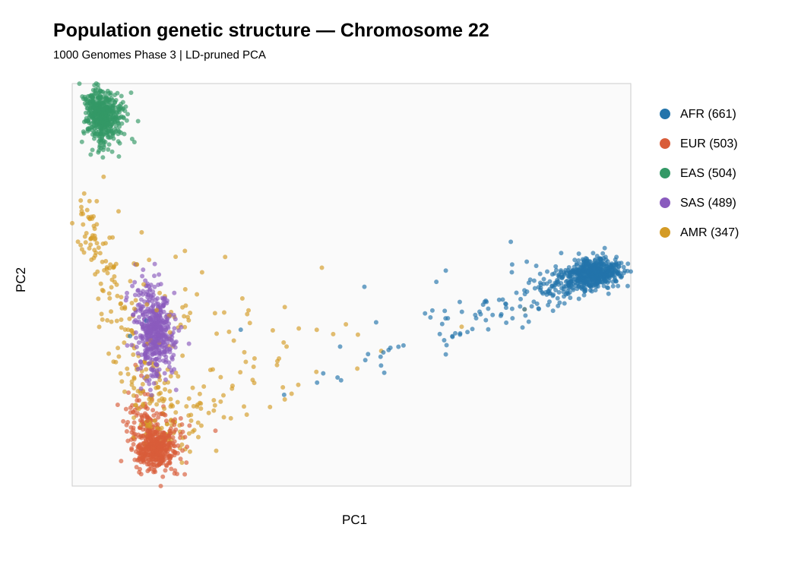
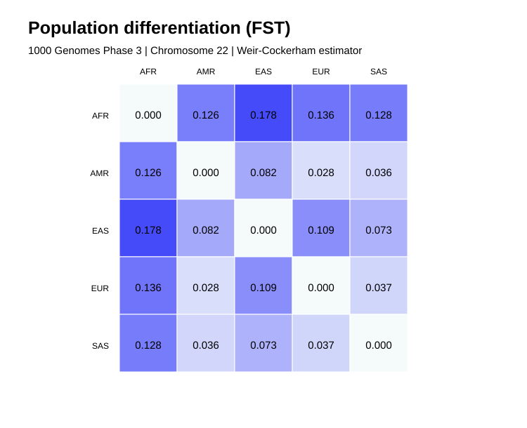

# Population Genomics | 1000 Genomes Phase 3

## Research Question

How does genetic variation on human chromosome 22 reflect population structure and allele-frequency differentiation across five 1000 Genomes reference superpopulations?

## Dataset

- Source: 1000 Genomes Project, Phase 3
- Genomic region: Chromosome 22
- Individuals: 2,504
- Superpopulations: AFR, AMR, EAS, EUR, SAS
- Input: Public genotype VCF and sample population panel

## Analysis Workflow

1. Filter biallelic SNPs and apply missingness and minor-allele-frequency criteria.
2. Perform linkage disequilibrium pruning for PCA.
3. Run principal component analysis using PLINK2.
4. Associate sample IDs with population metadata.
5. Calculate pairwise Weir-Cockerham FST using the filtered genotype data.
6. Visualize and interpret PCA and FST.

## Key Results

| Metric | Result |
|---|---:|
| Individuals analyzed | 2,504 |
| Filtered variants used for FST | 97,216 |
| LD-pruned variants used for PCA | 5,954 |
| Principal components calculated | 10 |
| Pairwise FST comparisons | 10 |

The PCA shows population-associated clustering and overlap. The highest observed FST was AFR–EAS (0.1780), while the lowest was AMR–EUR (0.0276).

## Figures

### Principal Component Analysis

### Population Differentiation

## Reproduce the Analysis

The primary workflow and plotting scripts are stored in `scripts/`:

- `01_population_pca.sh`
- `02_plot_pca.py`
- `03_plot_fst.py`

Requires PLINK2, Python 3, the original Phase 3 chromosome 22 VCF, and the matching sample metadata panel.

## Limitations

- Only chromosome 22 was analyzed; results are not genome-wide estimates.
- Superpopulations are study-defined reference groups, not discrete biological categories.
- PCA patterns depend on the selected variants and sampled individuals.
- FST reflects population-level allele-frequency differentiation, not individual genetic distance.
- Findings are descriptive rather than clinical.

## Detailed Results

[Analysis summary](results/project3_summary.md)
