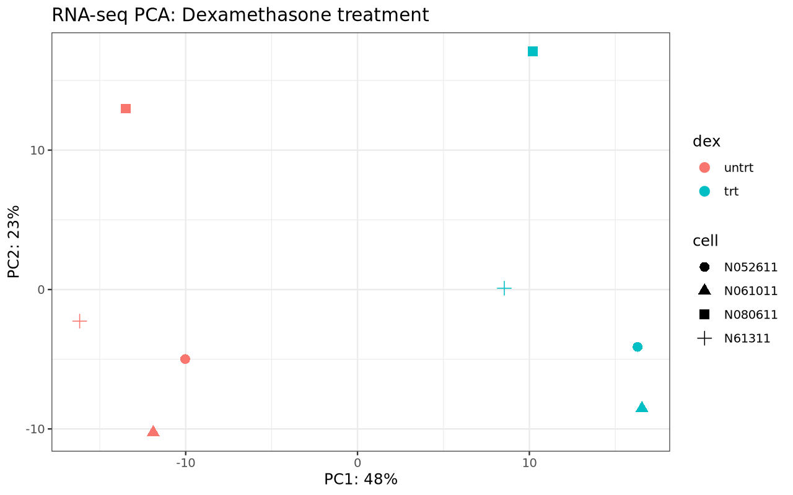
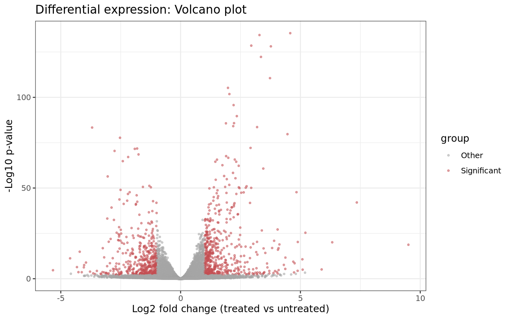
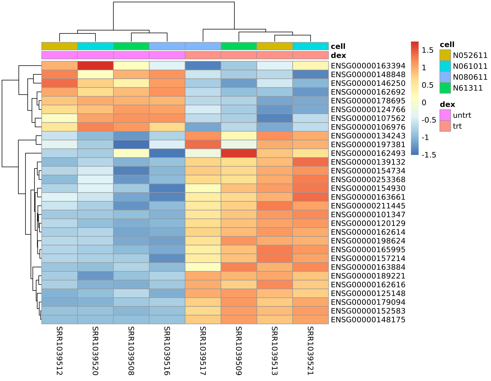

# Dexamethasone-Induced Gene Expression | Bulk RNA-seq

## Research Question

How does dexamethasone treatment affect gene expression
in human airway smooth muscle cells?

## Dataset

- Source: Bioconductor `airway` package
- Samples: 8
- Conditions: 4 treated and 4 untreated
- Biological structure: 4 cell lines, each represented
  in both conditions
- Input: Previously quantified gene-level RNA-seq counts

No raw FASTQ processing or transcript quantification
was performed in this analysis.

## Original Study and Data Citation

Himes BE et al. (2014). RNA-Seq Transcriptome Profiling
Identifies CRISPLD2 as a Glucocorticoid Responsive Gene
that Modulates Cytokine Function in Airway Smooth Muscle
Cells. PLOS ONE, 9(6), e99625.

- DOI: https://doi.org/10.1371/journal.pone.0099625
- GEO: https://www.ncbi.nlm.nih.gov/geo/query/acc.cgi?acc=GSE52778
- Dataset: Bioconductor airway package

This project analyzes published gene-level counts.
Raw FASTQ processing was not performed.

## Methods

1. Load the airway count data and sample metadata.
2. Set untreated samples as the reference condition.
3. Filter genes with fewer than 10 total counts.
4. Fit a DESeq2 model with design `~ cell + dex`.
5. Test treated versus untreated expression differences.
6. Apply Benjamini-Hochberg FDR correction.
7. Identify genes with adjusted p < 0.05 and
   absolute log2 fold change >= 1.
8. Generate PCA, volcano plot and heatmap.

### Tools

R, DESeq2, airway, ggplot2 and pheatmap.

## Main Results

- Samples: 8
- Genes after filtering: 22,369
- Differentially expressed genes: 1,018
- Upregulated genes: 531
- Downregulated genes: 487

These counts use adjusted p < 0.05 and |log2FC| >= 1.

## Figures

### PCA

### Volcano Plot

### Heatmap

### Volcano Plot Interpretation

The vertical axis shows -log10 of the unadjusted
p-value. Highlighted genes are selected using
adjusted p < 0.05 and |log2 fold change| >= 1.

## Results and Reproducibility

- [Differential expression table](results/tables/differential_expression.csv)
- [Sample metadata](results/tables/sample_metadata.csv)
- [Analysis summary](results/analysis_summary.md)
- [Software session information](results/session_info.txt)
- [Full analysis script](scripts/airway_deseq2.R)

Run from the `rnaseq` directory with an R environment
containing DESeq2, airway, ggplot2 and pheatmap:

`Rscript scripts/airway_deseq2.R`

The analysis uses the count data distributed with
the Bioconductor airway package.

## Scientific Limitations

This is a small, paired-by-cell-line experimental
dataset. The DESeq2 design accounts for cell-line effects.

Differential expression results indicate statistical
associations with treatment under this model.

The project begins with published gene counts, so it
does not demonstrate raw read quality control, alignment
or transcript quantification.

Gene expression changes do not independently establish
downstream mechanisms or clinical effects.
