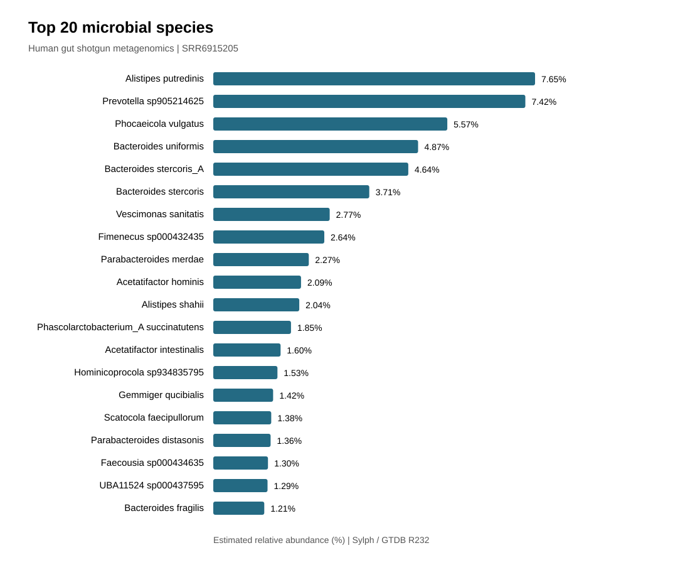

# Shotgun Metagenomic Profiling of the Human Gut Microbiome

## Project Overview

This project investigates the taxonomic composition of a human gut microbial community using publicly available whole-metagenome shotgun sequencing data.

The workflow integrates sequencing quality assessment, read preprocessing, taxonomic profiling, and biological interpretation, with an emphasis on reproducibility and methodological transparency.

## Research Question

What is the taxonomic composition of the microbial community represented in a publicly available human fecal shotgun metagenomic sample?

## Objectives

1. Assess the quality of raw paired-end sequencing reads.
2. Identify sequencing artifacts and determine appropriate preprocessing steps.
3. Perform taxonomic classification using a documented reference database.
4. Estimate the relative abundance of detected microbial taxa.
5. Visualize microbial community composition.
6. Evaluate methodological limitations and potential sources of bias.

## Dataset

| Attribute | Information |
|---|---|
| Sample ID | VF32 |
| BioSample | SAMN08814006 |
| BioProject | PRJNA447983 |
| SRA Experiment | SRX3862805 |
| SRA Run | SRR6915205 |
| Sample material | Human stool |
| Sequencing strategy | WGS / Shotgun metagenomics |
| Library source | METAGENOMIC |
| Library layout | Paired-end |
| Sequencing instrument | Illumina HiSeq 2500 |

**Data source:** https://www.ncbi.nlm.nih.gov/sra/SRX3862805

The sample originates from a study investigating fecal metagenomes in colorectal cancer cohorts. The clinical status of this specific donor has not yet been established from the reviewed metadata.

## Planned Computational Workflow

1. Data retrieval — NCBI SRA Toolkit
2. Raw read quality assessment — FastQC
3. Read preprocessing — fastp, where justified by QC
4. Taxonomic profiling — tool and reference database to be selected
5. Relative abundance analysis
6. Data visualization and biological interpretation

## Scientific Considerations

- Taxonomic assignments depend on the reference database and classification method.
- Relative abundance estimates may be affected by genome length, sequencing depth, and unclassified reads.
- Detection of microbial DNA does not establish microbial viability or activity.
- A single sample cannot establish disease associations or population-level differences.
- Preprocessing decisions will be based on observed sequencing quality.

## Results

**Status: Core computational analysis completed**

### Sequencing and taxonomic profiling

Human gut shotgun metagenomic sample SRR6915205 was processed
through read quality control, trimming, host-read removal,
and taxonomic profiling using Sylph with GTDB R232.

The taxonomic profile contained 273 species-level entries.

### Most abundant assigned taxa

| Species | Relative abundance |
|---|---:|
| Alistipes putredinis | 7.65% |
| Prevotella sp905214625 | 7.42% |
| Phocaeicola vulgatus | 5.57% |
| Bacteroides uniformis | 4.87% |
| Bacteroides stercoris_A | 4.64% |

### Visualization

### Biological interpretation

The sample contains a diverse gut-associated microbial community.
These findings describe the taxonomic composition of one sample
and cannot establish disease associations or clinical diagnoses.

### Limitations

- Single-sample analysis without comparison groups.
- Taxonomic estimates depend on database coverage.
- Relative abundances are estimates, not absolute cell counts.
- The individual donor's clinical status has not been confirmed.

### Reproducibility

The `scripts/` directory contains the computational workflow.
Selected quality reports, figures, and taxonomic outputs are
available in `results/`.

Large raw sequencing files and reference databases are excluded
from the public repository.

### Project status

Core analysis completed. Scientific review and documentation ongoing.

## Sequencing Quality and Host Screening

The preprocessing workflow retained 27,278,332 of
27,285,314 original reads. The post-filtering Q30 rate
was 91.14%.

Host-reference screening retained 13,639,162 of
13,639,166 read pairs. Only four pairs were excluded.
This unusually low alignment rate requires cautious
interpretation and does not establish the absence
of human-origin sequences.

[Full quality-control assessment](results/fastp/qc_summary.md)

## Reproducibility Documentation

[Reproducibility Documentation](docs/REPRODUCIBILITY.md)
